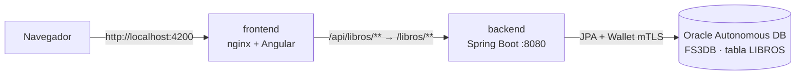
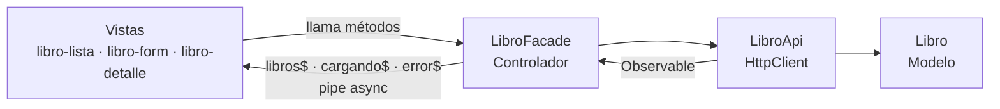
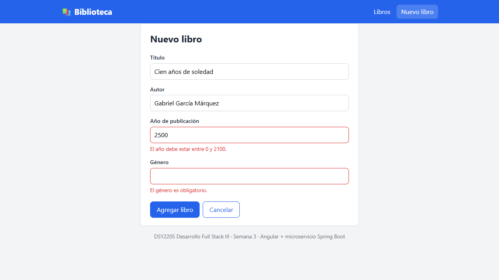
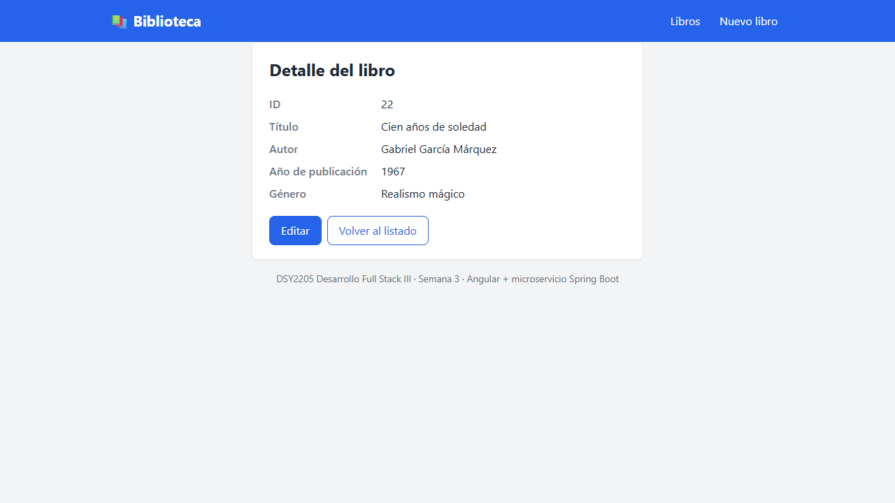
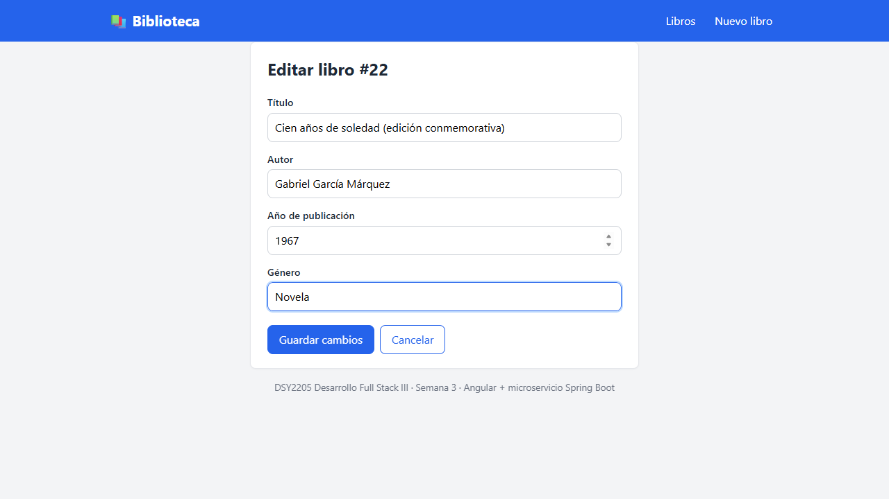
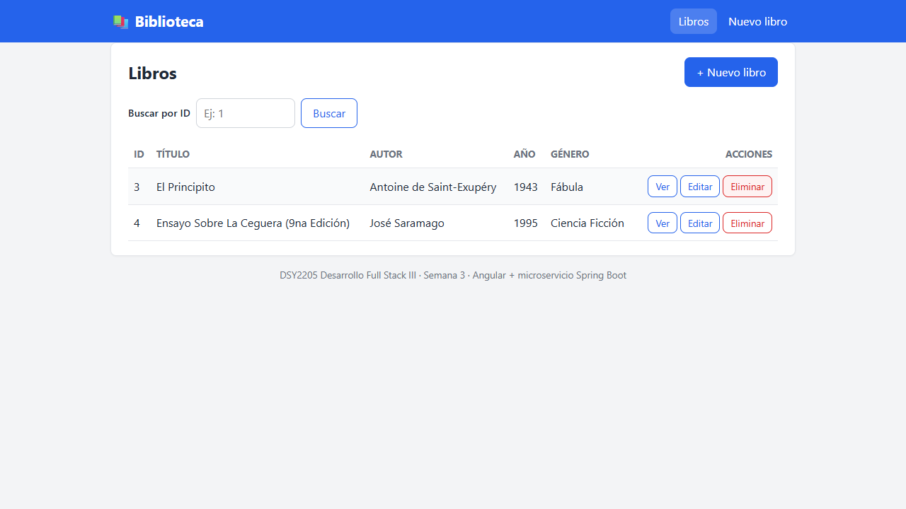
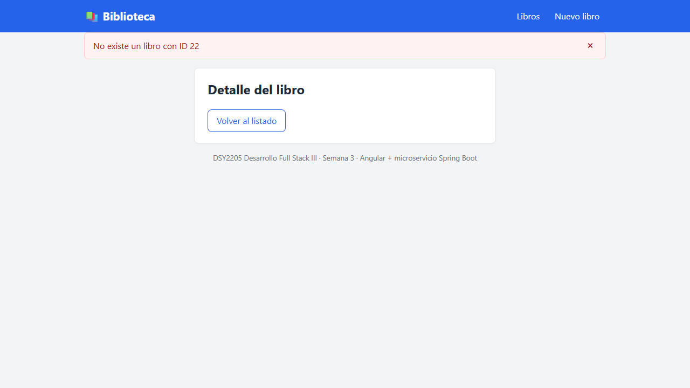

# FS3_Exp1_S1 — Biblioteca (microservicio + frontend Angular)

DSY2205 Desarrollo Full Stack III

| Semana | Actividad | Qué se agrega |
|---|---|---|
| 1 | *"Desarrollando nuestro microservicio"* | Microservicio **Java 21 + Spring Boot 3** con CRUD de libros sobre **Oracle Autonomous Database** (carpeta `backend/`) |
| **3** | *"Aplicando un patrón de diseño a nuestro desarrollo"* (Exp. 2, formativa 2) | Aplicación web **Angular 22** que gestiona los libros consumiendo los 5 endpoints del microservicio, construida con el arquetipo **MVC** y patrones de diseño (carpeta `frontend/`) |

## Arquitectura



- El frontend llama siempre a la URL relativa `/api/libros`. Un proxy (nginx en Docker o `proxy.conf.json` con `ng serve`) la reenvía al microservicio quitando el prefijo `/api`.
- Así el navegador ve el frontend y la API en el **mismo origen** y no se necesita configurar CORS en el backend.

## Estructura del repositorio

```
FS3_Exp1_S1/
├── docker-compose.yml          # Levanta backend + frontend
├── .env.example                # Plantilla de credenciales (copiar como .env, no se sube)
├── docs/evidencias/            # Pantallazos de la aplicación funcionando
├── backend/                    # Microservicio de la semana 1
│   ├── src/main/java/cl/duoc/biblioteca
│   │   ├── model/Libro.java                 # Entidad JPA (tabla LIBROS)
│   │   ├── repository/LibroRepository.java  # JpaRepository
│   │   ├── service/                         # LibroService + LibroServiceImpl (CRUD)
│   │   ├── controller/LibroController.java  # REST /libros
│   │   └── exception/                       # Manejo de errores 404 / 400
│   ├── sql/crear_tabla_libros.sql           # Script de la tabla + datos de prueba
│   ├── postman/                             # Colección Postman
│   ├── Dockerfile  .dockerignore
│   └── pom.xml  mvnw  mvnw.cmd
└── frontend/                   # Aplicación Angular de la semana 3
    ├── src/app
    │   ├── models/libro.ts                  # Modelo
    │   ├── services/libro-api.ts            # Acceso HTTP a los 5 endpoints
    │   ├── facades/libro-facade.ts          # Controlador / Facade con el estado
    │   ├── components/
    │   │   ├── libro-lista/                 # Vista: tabla, buscar por ID, ver/editar/eliminar
    │   │   ├── libro-form/                  # Vista: crear y editar
    │   │   └── libro-detalle/               # Vista: detalle por ID
    │   ├── app.routes.ts                    # Rutas
    │   └── app.config.ts                    # HttpClient + router
    ├── src/environments/environment.ts      # apiUrl = '/api/libros'
    ├── proxy.conf.json                      # Proxy para ng serve
    ├── nginx.conf  Dockerfile  .dockerignore
    └── package.json  angular.json
```

## Arquetipo y patrones de diseño (frontend)

El frontend sigue el arquetipo **Modelo-Vista-Controlador (MVC)**:



| Patrón | Tipo | Dónde | Cómo se aplica |
|---|---|---|---|
| **MVC** | Arquetipo / patrón arquitectónico | `models/`, `services/`, `facades/`, `components/`, `app.routes.ts` | **Modelo:** interfaz `Libro` + `LibroApi`. **Vista:** componentes con sus plantillas HTML. **Controlador:** `LibroFacade` y el enrutador, que deciden qué vista se muestra y comunican la vista con el modelo. |
| **Singleton** | Diseño (creacional) | `services/libro-api.ts`, `facades/libro-facade.ts` | `@Injectable({ providedIn: 'root' })`: Angular crea una sola instancia para toda la aplicación, así todas las vistas comparten el mismo estado. |
| **Observer** | Diseño (comportamiento) | `services/libro-api.ts`, `facades/libro-facade.ts`, plantillas `*.html` | `LibroApi` devuelve `Observable`. El facade guarda el estado en `BehaviorSubject` y lo expone como `libros$`, `cargando$`, `error$` y `seleccionado$`. Las vistas se suscriben con el pipe `async` y se actualizan solas cuando cambia la lista. |
| **Facade** | Diseño (estructural) | `facades/libro-facade.ts` | Interfaz simple (`cargarLibros`, `seleccionar`, `agregar`, `actualizar`, `eliminar`) que oculta el HTTP, el estado y el manejo de errores. Traduce las respuestas 400/404 del backend a mensajes legibles. Las vistas no conocen `HttpClient` ni la API. |
| **Decorator** | Diseño (estructural) | Todos los componentes y servicios | `@Component` y `@Injectable` agregan metadatos y comportamiento a las clases (selector, plantilla, inyección de dependencias) sin modificarlas. |

Cada archivo tiene comentarios que explican su rol en el arquetipo y el patrón que aplica.

## Microservicio (backend)

### Entidad Libro

| Atributo | Tipo | Columna |
|---|---|---|
| id | Long (autogenerado) | ID |
| titulo | String | TITULO |
| autor | String | AUTOR |
| anioPublicacion | Integer (0–2100) | ANIO_PUBLICACION |
| genero | String | GENERO |

El modelo del frontend (`frontend/src/app/models/libro.ts`) tiene exactamente los mismos atributos.

### Endpoints y su uso en el frontend

| Método | URL del microservicio | Método de `LibroApi` | Vista que lo usa |
|---|---|---|---|
| GET | `/libros` | `listar()` | `libro-lista` |
| GET | `/libros/{id}` | `obtenerPorId(id)` | `libro-detalle` (y buscar por ID), `libro-form` al editar |
| POST | `/libros` | `crear(libro)` | `libro-form` (nuevo) |
| PUT | `/libros/{id}` | `actualizar(id, libro)` | `libro-form` (editar) |
| DELETE | `/libros/{id}` | `eliminar(id)` | `libro-lista` |

Ejemplo de body (POST / PUT):

```json
{
  "titulo": "El Principito",
  "autor": "Antoine de Saint-Exupéry",
  "anioPublicacion": 1943,
  "genero": "Fábula"
}
```

Errores: `404` → `{"status":404,"error":"No existe un libro con ID 5"}` · `400` → `{"error":"Datos inválidos","detalle":{"titulo":"El título es obligatorio"}}`.

### Configuración de Oracle Cloud

1. En Oracle Cloud crear una **Autonomous Database** (Always Free).
2. Descargar el **Wallet** (*Database connection → Download wallet*) y descomprimirlo en `backend/wallet/`. Está en `.gitignore` y **no se sube**.
3. Revisar en `backend/wallet/tnsnames.ora` el nombre del servicio (ej: `fs3db_tp`).
4. La tabla `LIBROS` se crea automáticamente al iniciar (`ddl-auto=update`). También se puede crear con `backend/sql/crear_tabla_libros.sql`.

## Cómo levantar todo con Docker (recomendado)

Requisitos: Docker Desktop y el wallet en `backend/wallet/`.

```powershell
cd C:\proyectos\FS3_Exp1_S1
copy .env.example .env      # y completar DB_PASSWORD (y DB_SERVICE/DB_USER si cambian)
docker compose up --build
```

| Servicio | URL |
|---|---|
| Aplicación web (Angular + nginx) | http://localhost:4200 |
| Microservicio (acceso directo) | http://localhost:8080/libros |

- **backend:** se compila con Maven dentro de la imagen y lee `DB_SERVICE`, `DB_USER` y `DB_PASSWORD` desde `.env`. El wallet se monta en `/app/wallet` como solo lectura.
- **frontend:** se compila con `npm run build` y lo sirve nginx. nginx reenvía `/api/**` al contenedor `backend` y hace el *fallback* a `index.html` para las rutas de Angular.

Detener: `docker compose down`.

## Cómo levantarlo sin Docker

**1. Microservicio** (terminal 1). Se puede usar el archivo `backend/application-local.properties`, que tampoco se sube:

```properties
spring.datasource.url=jdbc:oracle:thin:@fs3db_tp?TNS_ADMIN=C:/proyectos/FS3_Exp1_S1/backend/wallet
spring.datasource.username=ADMIN
spring.datasource.password=tu_clave
```

```powershell
cd C:\proyectos\FS3_Exp1_S1\backend
.\mvnw.cmd spring-boot:run "-Dspring-boot.run.profiles=local"
```

O con variables de entorno (`DB_SERVICE`, `TNS_ADMIN`, `DB_USER`, `DB_PASSWORD`) y `.\mvnw.cmd spring-boot:run`.

**2. Frontend** (terminal 2). Requiere Node.js 22 o superior:

```powershell
cd C:\proyectos\FS3_Exp1_S1\frontend
npm install
npm start          # ng serve → http://localhost:4200
```

`ng serve` usa `proxy.conf.json`, que redirige `/api/**` a `http://localhost:8080/**`.

## Pruebas

```powershell
cd backend;  .\mvnw.cmd test             # 6 pruebas del controlador (MockMvc + Mockito, sin BD)
cd frontend; npx ng test --watch=false   # 19 pruebas Vitest
```

Pruebas del frontend:

- `libro-api.spec.ts`: verifica con `HttpTestingController` el método HTTP, la URL y el body de cada uno de los 5 endpoints, y que el servicio es singleton.
- `libro-facade.spec.ts`: la lista observada se actualiza al cargar, agregar, actualizar y eliminar. También cubre la traducción de errores 404, 400 y "servicio no disponible".

La colección Postman (`backend/postman/`) sigue sirviendo para probar el microservicio directo en `http://localhost:8080`:

```powershell
npx newman run .\backend\postman\Biblioteca.postman_collection.json
```

## Evidencias

### Semana 3: aplicación Angular

Pantallazos tomados en http://localhost:4200 con la aplicación levantada con `docker compose up --build` y conectada a Oracle Autonomous Database. Las imágenes están en [`docs/evidencias/`](docs/evidencias).

**1. Listado de libros (GET /libros)**


**2. Nuevo libro: validaciones del formulario (año 0–2100 y campos obligatorios)**



**3. Libro creado (POST /libros) → la app muestra el detalle con el ID generado por Oracle**


**4. El listado se actualiza con el libro nuevo (patrón Observer)**


**5. Buscar por ID (GET /libros/{id})**




**6. Editar libro (PUT /libros/{id})**




**7. Eliminar libro (DELETE /libros/{id}): desaparece del listado**



**8. Consultar el libro eliminado: el 404 del microservicio se muestra como mensaje legible**



**Contenedores corriendo (`docker compose ps`)**

```
NAME                  STATUS         PORTS
biblioteca-backend    Up 9 minutes   0.0.0.0:8080->8080/tcp
biblioteca-frontend   Up 7 minutes   0.0.0.0:4200->80/tcp
```

Log del backend dentro del contenedor:

```
HikariPool-1 - Start completed.
Database version: 19.33
Tomcat started on port 8080 (http) with context path '/'
Started BibliotecaApplication in 12.592 seconds
```

**Pruebas unitarias**

```
> npx ng test --watch=false
 Test Files  3 passed (3)
      Tests  19 passed (19)

> .\mvnw.cmd test
[INFO] Tests run: 6, Failures: 0, Errors: 0, Skipped: 0
[INFO] BUILD SUCCESS
```

Resultados de la verificación:

- `docker compose up --build`: el backend arranca con `HikariPool-1 - Start completed`, `Database version: 19.33` y `Started BibliotecaApplication` dentro del contenedor.
- Desde http://localhost:4200 se probó el CRUD completo contra Oracle: listar, buscar por ID, crear (con las validaciones de año 0–2100 y campos obligatorios), editar, eliminar, y el aviso del 404 al consultar el libro eliminado.
- `ng test`: 3 archivos y 19 pruebas aprobadas. `ng build`: sin errores. `mvnw test`: `Tests run: 6, Failures: 0` → `BUILD SUCCESS`.

### Semana 1: microservicio

**Base de datos en Oracle Cloud**


**Conexión a Oracle Autonomous Database (Oracle Cloud)**

- El alias `fs3db_tp` del wallet apunta a `adb.sa-santiago-1.oraclecloud.com`, puerto `1522`, protocolo `tcps` (mTLS).
- Log de inicio:

```
The following 1 profile is active: "local"
HikariPool-1 - Start completed.
Database version: 19.33
Started BibliotecaApplication in 5.732 seconds
```

**Tabla `LIBROS` generada por Hibernate (JPA) en Oracle**

```sql
create table libros (
    id number(19,0) generated by default as identity,
    anio_publicacion number(10,0) not null check ((anio_publicacion<=2100) and (anio_publicacion>=0)),
    autor varchar2(150 char) not null,
    genero varchar2(80 char) not null,
    titulo varchar2(200 char) not null,
    primary key (id)
)
```

**Pruebas de los endpoints en Postman**


**Pruebas de los endpoints (curl)**

| Solicitud | HTTP | Respuesta |
|---|---|---|
| `POST /libros` | 201 | `{"id":5,"titulo":"Rayuela","autor":"Julio Cortazar","anioPublicacion":1963,"genero":"Novela"}` |
| `GET /libros/5` | 200 | `{"id":5,"titulo":"Rayuela",...}` |
| `PUT /libros/5` | 200 | `{"id":5,"titulo":"Rayuela (edicion conmemorativa)",...,"genero":"Novela experimental"}` |
| `DELETE /libros/5` | 204 | *(sin cuerpo)* |
| `GET /libros/5` | 404 | `{"status":404,"error":"No existe un libro con ID 5"}` |
